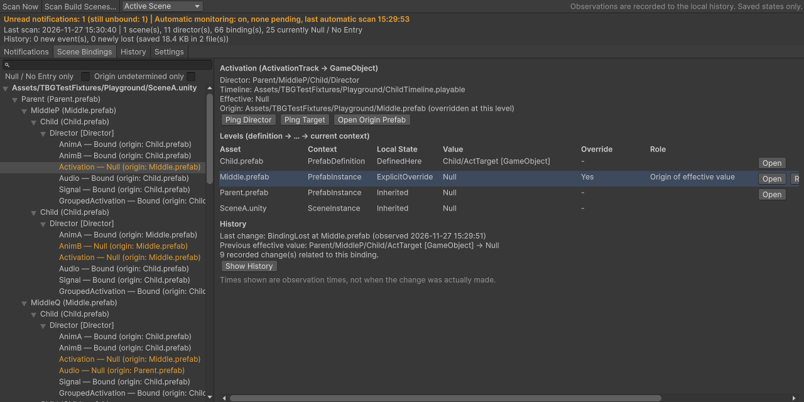
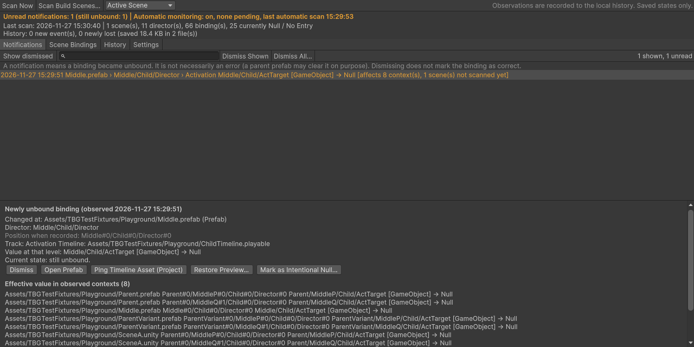
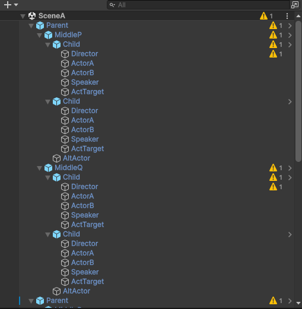
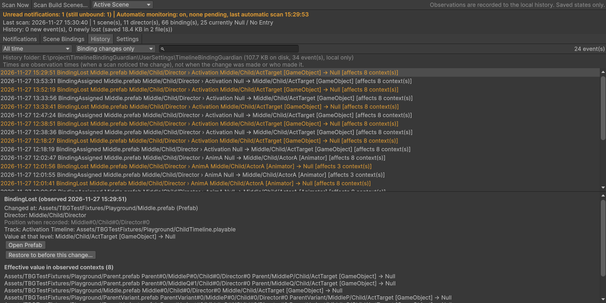
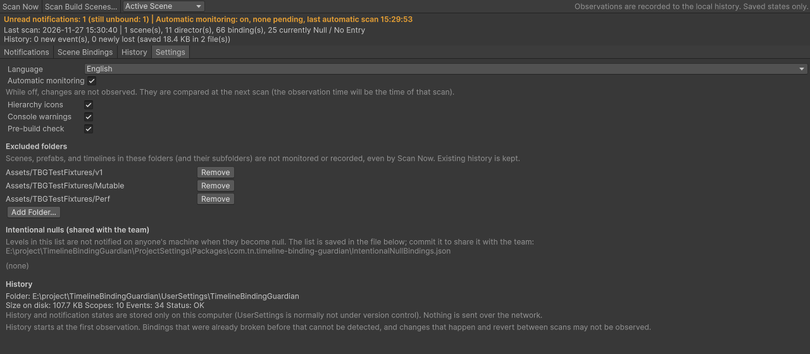
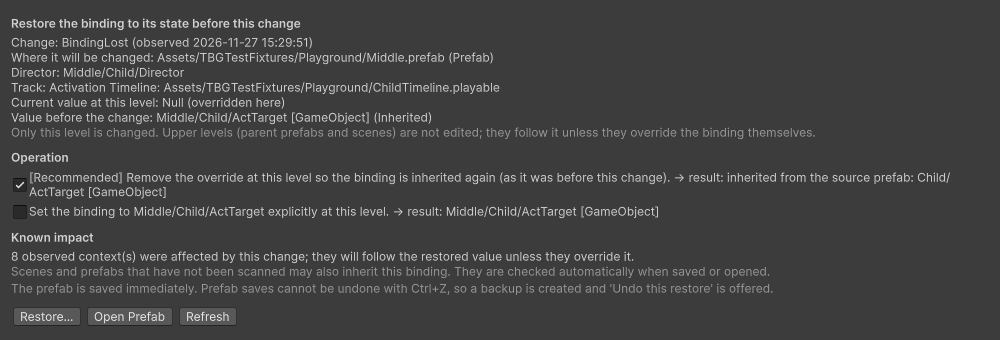

# Timeline Binding Guardian

English | [日本語](README.md)

A Unity Editor tool that watches Timeline bindings (`PlayableDirector` generic bindings), keeps a history of their changes, notifies you when a binding is lost, and helps you restore it safely. It understands nested prefabs and prefab variants: it shows **which level** (scene, prefab, or nested prefab) changed a binding, not only the final value.

It runs in the Editor only. Nothing is added to your builds, and nothing is sent over the network.



*The binding is empty in the scene, and the window shows that the override in `Middle.prefab` is the cause.*

## Features

- **Automatic monitoring**: When you open or save a scene or prefab, the tool checks its Timeline bindings and records the changes. You do not need to start anything by hand.
- **Notifications**: When a binding that used to be bound becomes empty (null), you get:
  - a notification in the window,
  - a warning in the Console,
  - an icon in the Hierarchy, next to the object and the scene.
- **Origin of the value**: For each binding, the tool shows the level the value comes from. This can be:
  - a scene override,
  - a nested prefab,
  - a prefab variant,
  - the original prefab.
- **History**: Lists every observed change with when it happened, the level where it changed, and the value before and after. You can filter it, for example to show only changes since the last build.
- **Safe restore**: Restores a lost binding at the level where it was lost. Before you restore, a preview shows exactly what will change:
  - In a prefab, the restore removes the override that cleared the binding, or sets the binding back to the value it had. A backup of the prefab is made first.
  - In a scene, the change is made in the open scene and can be undone with Ctrl+Z. The scene is not saved for you.
- **Pre-build check**: When a build starts, the tool checks the open build scenes and the prefabs they use. It never stops the build.
- **Build scene scan**: Checks every enabled scene in Build Settings. Closed scenes are opened temporarily, one at a time, and closed again.
- **Intentional nulls shared with your team**: If a binding is meant to be empty, you can register that level in a shared list. Commit the list and nobody on the team is notified about it.
- **English / Japanese UI**: By default the language follows your OS language setting. You can also choose it in Settings.

## Requirements

| | Version |
|---|---|
| Unity | 6000.0 or later |
| Timeline (`com.unity.timeline`) | 1.8.13 or later (Unity 6000.6 uses the Timeline 6.6.0 built into Unity) |

Verified versions:

| Unity | Timeline | Verified by |
|---|---|---|
| 6000.0.25f1 | 1.8.13 | Automated tests |
| 6000.3.27f2 | 1.8.13 | Automated tests and manual use |
| 6000.6.0f1 | 6.6.0 (built into Unity) | Automated tests |

Unity 6000.4 and 6000.5 are supported based on Unity's official API documentation, but have not been tested. Other versions are not guaranteed to work.

## Installation

1. In the Unity Editor, open **Window > Package Manager**.
2. Click **+** and choose **Install package from git URL...**.
3. Enter the following URL and click **Install**:

   ```
   https://github.com/tomoyuki710/TimelineBindingGuardian.git?path=/Packages/com.tn.timeline-binding-guardian
   ```

   To pin a specific version (recommended), add the tag at the end:

   ```
   https://github.com/tomoyuki710/TimelineBindingGuardian.git?path=/Packages/com.tn.timeline-binding-guardian#v0.1.1
   ```

4. After Unity finishes compiling, open **Window > Timeline Binding Guardian**.

Installing the package does not change any of your scenes or prefabs.

Git must be installed for Unity to install a package from a Git URL.

### Updating and removing

- **Update**: In Package Manager, select **Timeline Binding Guardian** and click **Update**. If you installed it with a tag, install it again with the new tag instead.
- **Remove**: In Package Manager, select **Timeline Binding Guardian** and click **Remove**.
  - The history stays in `UserSettings/TimelineBindingGuardian/`. Delete that folder if you do not need it.
  - If your team uses the intentional-null list, it is also left in `ProjectSettings/Packages/com.tn.timeline-binding-guardian/`.

## Getting started

1. Open **Window > Timeline Binding Guardian**.
2. The open, saved scenes and the prefabs they use are checked automatically. The first check is saved as the starting point.
   - Bindings that are already empty at this point are **not** reported. The tool can only tell that a binding was lost if it has seen it bound before.
3. Work as usual. When a binding is lost and the scene or prefab is saved, it appears in the **Notifications** tab.

   

   A warning icon also appears in the Hierarchy, next to the affected objects and the scene. Click it to show or dismiss the notifications.

   

### The window

| Tab | What it shows |
|---|---|
| **Notifications** | Bindings that were lost. Select one to see which level changed it, then use **Restore Preview…** or **Dismiss**. |
| **Scene Bindings** | The current bindings of the open scenes, level by level (scene, nested prefabs, original prefab). |
| **History** | All recorded changes, with filters for the period (including "Since last build") and the target. |
| **Settings** | Monitoring, Hierarchy icons, Console warnings, the pre-build check, language, excluded folders, and the intentional-null list. |

Use **Scan Now** to check the open scenes right away. Use **Scan Build Scenes…** to check every scene in Build Settings.

<details>
<summary>History tab</summary>



</details>

<details>
<summary>Settings tab</summary>



</details>

### Restoring a binding

1. Select the notification and click **Restore Preview…**. In **History**, select the change and click **Restore to before this change…**.
2. A preview window shows:
   - the level that will be changed,
   - the current value,
   - the value it will be restored to.

   

3. Click **Restore…** (or **Remove Override…** when removing the override is enough), then click **Restore** in the confirmation.
   - **Prefab**: The prefab is saved. A backup is written first to `UserSettings/TimelineBindingGuardian/backups/`. Prefab saves cannot be undone with Ctrl+Z, so use **Undo this restore** instead.
   - **Scene**: The scene is marked as modified but not saved. Undo with Ctrl+Z.

### Intentional nulls (shared with the team)

Sometimes a binding is cleared on purpose, for example in a parent prefab. Dismissing a notification only hides it on your machine, so your teammates are still notified after they pull the change. To stop that:

1. Click **Mark as Intentional Null…** on the notification, or on the level row in **Scene Bindings**.
2. The level is added to `ProjectSettings/Packages/com.tn.timeline-binding-guardian/IntentionalNullBindings.json`.
3. Commit that file. From then on, nobody on the team is notified when that level becomes null.

The change is still recorded in the history. You can remove a registration in **Settings**.

## Where data is stored

| Data | Location | Version control |
|---|---|---|
| History, notification states, settings | `UserSettings/TimelineBindingGuardian/` | Normally not committed (stays on your machine) |
| Backups made before restoring a prefab | `UserSettings/TimelineBindingGuardian/backups/` | Normally not committed (not deleted automatically) |
| Intentional-null list | `ProjectSettings/Packages/com.tn.timeline-binding-guardian/IntentionalNullBindings.json` | Commit it to share with the team |

Nothing is stored inside the package itself.

## Limitations

- **No history from before the first check.** A binding that was already empty when the tool first saw it is not reported.
- **Not every moment is recorded.** Monitoring is based on opening and saving scenes and prefabs. If a binding is changed and changed back before saving, the tool does not see it.
- **Unsaved scenes are not recorded.** They have no stable ID until they are saved.
- **Intentional nulls are notified by default.** The tool cannot tell whether a null was intended. Register it in the intentional-null list if it was.
- **Only `PlayableDirector` generic bindings are covered.** `ExposedReference` fields in clips are not.
- **Some cases cannot be restored automatically.** For example, the object that was bound may have been deleted, or the prefab may be read-only. In those cases the tool tells you why and you fix it by hand.
- **Only the versions listed under [Requirements](#requirements) have been verified.**

## License

[MIT License](LICENSE)
