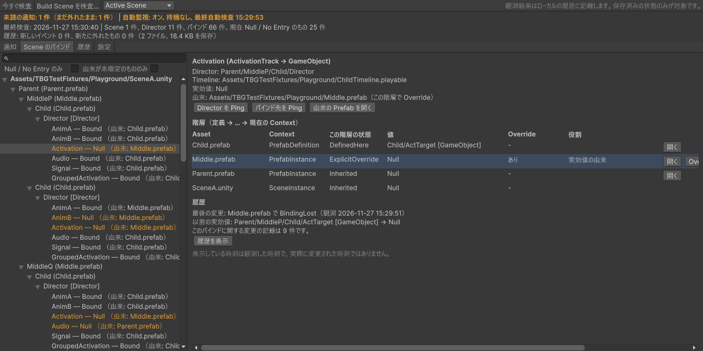
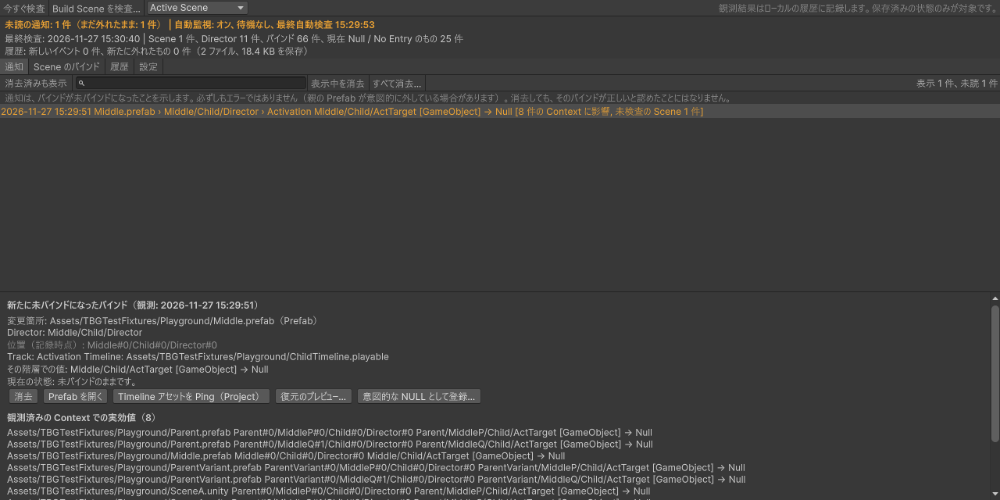
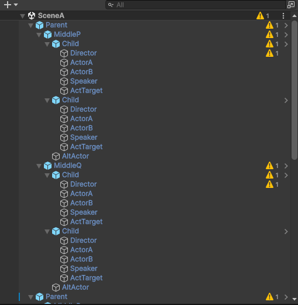
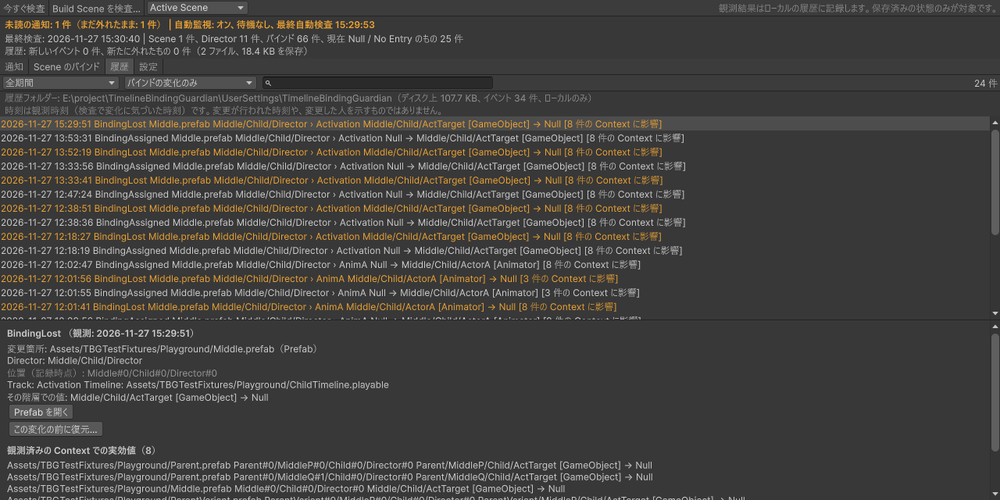
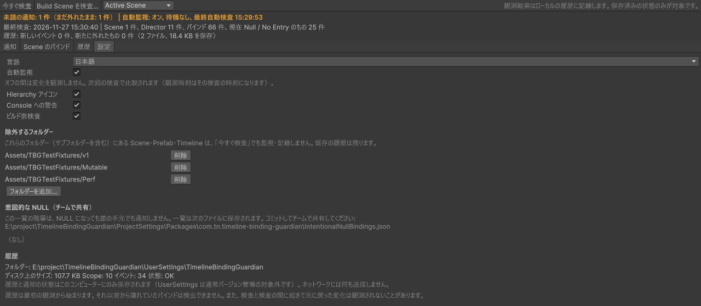
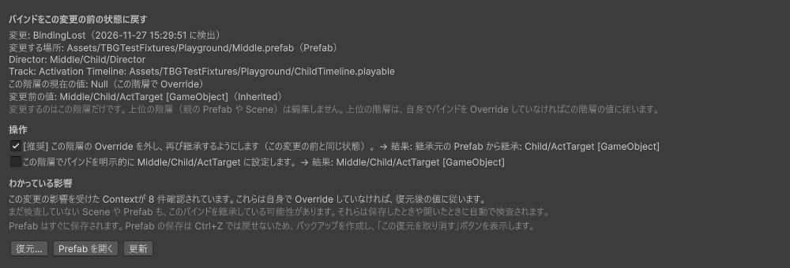

# Timeline Binding Guardian

[English](README.md) | 日本語

Timeline のバインド（`PlayableDirector` の Generic Binding）を見張る Unity Editor 用のツールです。次のことができます。

- バインドの変化を履歴に残します。
- バインドが外れたら通知します。
- 外れたバインドを安全に復元する手助けをします。

Nested Prefab や Prefab Variant にも対応しています。最終的な値だけでなく、**どの階層**（Scene・Prefab・Nested Prefab）でバインドが変わったかを表示します。

Editor の中だけで動きます。ビルドには何も含まれず、ネットワークにも何も送信しません。



*Scene ではバインドが空になっていて、原因が `Middle.prefab` の Override であることが分かります。*

## できること

- **自動監視**: Scene や Prefab を開いたとき・保存したときに Timeline のバインドを検査し、変化を記録します。手動で何かを始める必要はありません。
- **通知**: バインドされていたものが空（NULL）になると、次の形で知らせます。
  - ウィンドウの通知
  - Console への警告
  - Hierarchy のアイコン（オブジェクトの横と Scene の横）
- **値の出どころ**: バインドごとに、値がどの階層から来ているかを表示します。
  - Scene の Override
  - Nested Prefab
  - Prefab Variant
  - 元の Prefab
- **履歴**: 観測した変化をすべて一覧にします。それぞれ、いつ・どの階層で・何から何に変わったかが分かります。前回ビルド以降だけを表示するなど、絞り込みもできます。
- **安全な復元**: 外れたバインドを、外れた階層で元に戻します。実行前に、何が変わるかをプレビューで確認できます。
  - Prefab の場合: バインドを消した Override を外すか、元の値を設定し直します。先に Prefab のバックアップを作ります。
  - Scene の場合: 開いている Scene を変更し、Ctrl+Z で取り消せます。Scene の保存はしません。
- **ビルド前検査**: ビルドの開始時に、開いている Build Scene と、それらが使う Prefab を検査します。ビルドは止めません。
- **Build Scene の一括検査**: Build Settings で有効な Scene をすべて検査します。閉じている Scene は 1 つずつ一時的に開き、検査後に閉じます。
- **意図的な NULL をチームで共有**: わざと空にしているバインドは、その階層を共有リストに登録できます。リストのファイルをコミットすると、チームの誰の手元でも通知されなくなります。
- **英語・日本語の表示**: 既定では OS の言語設定に合わせます。Settings で選ぶこともできます。

## 動作環境

| | バージョン |
|---|---|
| Unity | Unity 6000.3 の 6000.3.27f2 以降（6000.3.27f2 で確認済み） |
| Timeline（`com.unity.timeline`） | 1.8.13（確認済み） |

上記以外のバージョンは確認しておらず、動作を保証しません。

## 導入方法

1. Unity Editor で **Window > Package Manager** を開きます。
2. **+** をクリックし、**Install package from git URL...** を選びます。
3. 次の URL を入力して **Install** をクリックします。

   ```
   https://github.com/tomoyuki710/TimelineBindingGuardian.git?path=/Packages/com.tn.timeline-binding-guardian
   ```

   バージョンを固定する場合（推奨）は、末尾にタグを付けます。

   ```
   https://github.com/tomoyuki710/TimelineBindingGuardian.git?path=/Packages/com.tn.timeline-binding-guardian#v0.1.0
   ```

4. Unity のコンパイルが終わったら、**Window > Timeline Binding Guardian** を開きます。

導入しても、既存の Scene や Prefab は変更しません。

Git URL からパッケージを入れるには、PC に Git がインストールされている必要があります。

### 更新と削除

- **更新**: Package Manager で **Timeline Binding Guardian** を選び、**Update** をクリックします。タグ付きの URL で導入した場合は、新しいタグの URL で導入し直してください。
- **削除**: Package Manager で **Timeline Binding Guardian** を選び、**Remove** をクリックします。
  - 履歴は `UserSettings/TimelineBindingGuardian/` に残ります。不要なら削除してください。
  - チームで意図的な NULL の一覧を使っていた場合、それも `ProjectSettings/Packages/com.tn.timeline-binding-guardian/` に残ります。

## 使い方

1. **Window > Timeline Binding Guardian** を開きます。
2. 開いている保存済みの Scene と、それらが使う Prefab を自動で検査します。最初の検査結果が、以後の比較の基準になります。
   - この時点ですでに空のバインドは**通知しません**。以前にバインドされていたのを見ていないと、外れたことが分からないためです。
3. いつもどおり作業します。バインドが外れて Scene や Prefab を保存すると、**通知** タブに表示されます。

   

   Hierarchy でも、影響を受けたオブジェクトと Scene の横に警告アイコンが出ます。クリックすると、通知の表示や消去ができます。

   

### ウィンドウ

| タブ | 内容 |
|---|---|
| **通知** | 外れたバインドの一覧です。選ぶと、どの階層で変わったかが分かります。**復元のプレビュー…** や **消去** ができます。 |
| **Scene のバインド** | 開いている Scene の現在のバインドを、階層ごと（Scene・Nested Prefab・元の Prefab）に表示します。 |
| **履歴** | 記録した変化のすべてです。期間（「前回ビルド以降」など）や対象で絞り込めます。 |
| **設定** | 自動監視、Hierarchy アイコン、Console への警告、ビルド前検査、言語、除外するフォルダー、意図的な NULL の一覧を設定します。 |

開いている Scene をすぐ検査したいときは **今すぐ検査** を使います。Build Settings のすべての Scene を検査したいときは **Build Scene を検査…** を使います。

<details>
<summary>履歴タブ</summary>



</details>

<details>
<summary>設定タブ</summary>



</details>

### バインドの復元

1. 通知を選び、**復元のプレビュー…** をクリックします。**履歴** からは、変化を選んで **この変化の前に復元…** をクリックします。
2. プレビューのウィンドウに次の内容が表示されます。
   - 変更する階層
   - 現在の値
   - 復元後の値

   

3. **復元…**（Override を外すだけで戻る場合は **Override を外す…**）をクリックし、確認で **復元** をクリックすると実行します。
   - **Prefab の場合**: Prefab を保存します。保存の前に、`UserSettings/TimelineBindingGuardian/backups/` にバックアップを書き出します。Prefab の保存は Ctrl+Z では戻せないため、取り消すときは **この復元を取り消す** を使います。
   - **Scene の場合**: Scene を変更済みの状態にします（保存はしません）。Ctrl+Z で取り消せます。

### 意図的な NULL（チームで共有）

親の Prefab などで、わざとバインドを空にすることがあります。通知の **消去** は自分の PC にしか保存されないため、変更を Pull した他のメンバーには通知が出ます。これを止めるには、次のようにします。

1. 通知、または **Scene のバインド** の階層の行で、**意図的な NULL として登録…** をクリックします。
2. その階層が `ProjectSettings/Packages/com.tn.timeline-binding-guardian/IntentionalNullBindings.json` に追加されます。
3. このファイルをコミットします。以後、その階層が NULL になっても、チームの誰の手元でも通知しません。

変化は履歴には記録されます。登録は **設定** から外せます。

## データの保存場所

| データ | 場所 | バージョン管理 |
|---|---|---|
| 履歴・通知の状態・設定 | `UserSettings/TimelineBindingGuardian/` | 通常はコミットしません（各自の PC に残ります） |
| Prefab を復元する前のバックアップ | `UserSettings/TimelineBindingGuardian/backups/` | 通常はコミットしません（自動では削除しません） |
| 意図的な NULL の一覧 | `ProjectSettings/Packages/com.tn.timeline-binding-guardian/IntentionalNullBindings.json` | チームで共有するならコミットします |

パッケージの中には何も保存しません。

## 制約

- **最初の検査より前の履歴は分かりません。** 最初に見たときにすでに空だったバインドは通知しません。
- **すべての瞬間を記録するわけではありません。** 監視は Scene や Prefab を開いたとき・保存したときに行います。保存する前に変更して元に戻した場合は検知しません。
- **未保存の Scene は記録しません。** 保存するまで、安定した ID がないためです。
- **意図的な NULL も、そのままでは通知されます。** NULL が意図したものかどうかは、ツールには判断できません。意図したものなら、意図的な NULL の一覧に登録してください。
- **対象は `PlayableDirector` の Generic Binding だけです。** クリップの `ExposedReference` は対象外です。
- **自動で復元できない場合があります。** 例えば、バインドされていたオブジェクトが削除された場合や、Prefab が読み取り専用の場合です。そのときは理由を表示するので、手動で直してください。
- **確認済みなのは [動作環境](#動作環境) のバージョンだけです。**

## ライセンス

[MIT License](LICENSE)
